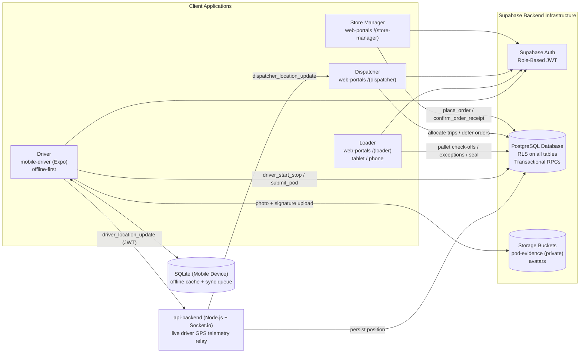

# Waypoint – Intelligent Logistics & Delivery Planning Platform

> **Tech-Triathlon 2026 (Rootcode) — Team Nexio**  
> An enterprise-grade, end-to-end logistics platform connecting **Ordering → Planning & Allocation → Warehouse Loading → Offline-First Delivery → Store Receipt Confirmation & Exception Handling** across Waypoint Group's Fresh, Style, and Tech retail brands.

---

## 🌐 Live Deployments

| Platform | Deployment URL | Description |
|---|---|---|
| **Web Portals** | [https://nexio-waypoint.vercel.app/login](https://nexio-waypoint.vercel.app/login) | Dispatcher, Loader, and Store Manager portals |
| **Driver Mobile App** | [https://nexio-waypoint-driver.vercel.app](https://nexio-waypoint-driver.vercel.app) | Responsive phone-sized driver application |

---

## 🔑 Demo Login Credentials

For judging and interactive testing, use the pre-configured credentials below. All accounts share the password `Waypoint@2026`:

| Role | Email | Password | Landing Page | Key Capabilities to Test |
|---|---|---|---|---|
| **Dispatcher** | `dispatch@waypoint.com` | `Waypoint@2026` | `/command-center` | Real-time command center, multi-constraint trip allocation, deferrals, live driver telemetry map |
| **Loader** | `load@waypoint.com` | `Waypoint@2026` | `/trip-queue` | Trip loading queue, reverse-stop LIFO pallet staging, discrepancy reporting, vehicle digital sealing |
| **Driver** | `driver@waypoint.com` | `Waypoint@2026` | Mobile Driver App | Route itinerary (TRIP 1042, 4 stops), turn-by-turn navigation, offline POD (photo + signature), background sync |
| **Store Manager** | `store@waypoint.com` | `Waypoint@2026` | `/overview` | Order placement with strict 16:00 cutoff, inbound delivery tracking, POD receipt confirmation, shortage reporting |

> **Additional Driver Accounts (for multi-trip testing):**  
> `driver2@waypoint.com` · `driver3@waypoint.com` · `driver4@waypoint.com` · `driver5@waypoint.com` · `driver6@waypoint.com` · `driver7@waypoint.com` · `driver8@waypoint.com`  
> *(Password for all drivers: `Waypoint@2026`)*

---

## 🧭 Step-by-Step Judge Walkthrough

The demo database seed initializes a dynamic delivery day relative to current execution time. Follow this 10-step sequence to verify the end-to-end operational flow:

### 1. Store Manager – Place Next-Day Order
1. Sign in as `store@waypoint.com` with `Waypoint@2026` at [nexio-waypoint.vercel.app/login](https://nexio-waypoint.vercel.app/login).
2. Navigate to **Orders** → **Place Order**.
3. Select tomorrow's delivery date (before the strict 16:00 daily cutoff) and enter payload specifications (e.g. ambient/chilled, weight, volume, item count).
4. *Validation Check:* Attempting to place an order after 16:00 Colombo time is rejected server-side by database RPCs.

### 2. Dispatcher – Review Inbound Volume & Fleet Health
1. Sign in as `dispatch@waypoint.com` with `Waypoint@2026`.
2. Land on `/command-center` to review total incoming store volume, available fleet assets, vehicle breakdown states, and capacity bottlenecks.

### 3. Dispatcher – Run Allocation Engine
1. Navigate to **Allocation** (`/allocation`).
2. Review automated multi-constraint grouping:
   - Volume and weight capacity limits per vehicle.
   - Temperature matching: Chilled orders strictly mapped to refrigerated reefer units.
   - Access matching: Van-only urban store locations mapped to vans.
   - Strict brand and district exclusivity per delivery trip.
   - Pre-dawn Fresh budget ($\le 270$ min) and Daytime Style/Tech budget ($\le 480$ min).
3. Orders exceeding operational fleet capacity are flagged for managed deferral.

### 4. Dispatcher – Manage Deferrals & Broadcast Alerts
1. Open **Deferrals** (`/deferrals`).
2. Review deferred orders, assign operational reasons, and queue them for priority Day+1 dispatch.
3. The store manager immediately receives a real-time notification under **Alerts**.

### 5. Loader – Warehouse Staging & Vehicle Sealing
1. Sign in as `load@waypoint.com` with `Waypoint@2026` on tablet or phone view.
2. Select **Trip Queue** (`/trip-queue`) → **TRIP 1042**.
3. Verify pallets loaded in **reverse stop order** (LIFO loading for seamless FIFO drop-off).
4. Simulate barcode scanning or manual check-off.
5. Report any missing or damaged pallet exceptions, then enter digital seal numbers and dispatch the vehicle.

### 6. Driver – Start Trip & Route Navigation
1. Open the Driver Mobile App at [nexio-waypoint-driver.vercel.app](https://nexio-waypoint-driver.vercel.app) or on mobile via Expo.
2. Sign in as `driver@waypoint.com` with `Waypoint@2026`.
3. View the assigned itinerary for **TRIP 1042** (4 stops) with arrival windows, store dock access conditions, and special handling instructions.
4. Tap **Start Trip** to begin live location streaming.

### 7. Driver – Offline Proof of Delivery (Zero-Connectivity Test)
1. Select **Stop 2 (Fresh Store #22)** and tap **Start Delivery**.
2. **Simulate Offline:** Enable **Airplane Mode** or disable network on your device.
3. Capture a delivery photo and collect the customer's on-screen signature on the digital signature pad.
4. Tap **Complete Delivery**.
5. *Offline Queue Verification:* The app displays the offline synchronization banner showing pending uploads safely stored in local SQLite storage.

### 8. Driver – Reconnect & Automatic Background Sync
1. Turn off Airplane Mode (re-enable internet connectivity).
2. The `BackgroundSyncManager` automatically detects network restoration, synchronizes queued transactions, uploads proof-of-delivery evidence to private Supabase Storage, and marks the stop completed.
3. The dispatcher's live tracking map updates in real time over WebSockets.

### 9. Store Manager – Inspect Proof of Delivery & Confirm Receipt
1. Switch back to the Store Manager portal (`store@waypoint.com`).
2. Navigate to **Receiving** (`/receiving`).
3. View the completed delivery along with the driver's geotagged photo, timestamp, and signature.
4. Verify received item counts, confirm receipt, or report a quantity shortage to automatically notify dispatch.

### 10. Store Manager – Audit History & Exception Tracking
1. Open **History** (`/history`) to inspect confirmed delivery receipts, past shortage exceptions, and end-to-end chain of custody records.

---

## 🏛️ System Architecture



---

## 📦 Project Structure

```
waypoint-logistics/
├── web-portals/               # Next.js 16 (App Router) web applications
│   ├── src/app/(dispatcher)/  # Command center, allocation, deferrals, tracking, fleet
│   ├── src/app/(loader)/      # Trip loading queue, reverse staging, pallet scanning, sealing
│   ├── src/app/(store-manager)/# Store overview, order placement, receiving, alerts, history
│   └── src/middleware.ts      # Server-side Supabase session & RBAC role router
│
├── mobile-driver/             # Cross-platform Expo driver application
│   ├── app/                   # Expo router screens: itinerary, stop detail, POD camera & signature
│   ├── services/              # Offline SQLite queue, background sync manager, location tracker
│   └── dist/                  # Static web export for browser judging deployment
│
├── api-backend/               # Node.js + Express + Socket.io realtime telemetry server
│   ├── src/server.js          # Authenticated WebSocket gateway for live driver tracking
│   └── src/controllers/       # Location ingest & database persistence
│
├── datathon/                  # Machine Learning & Combinatorial Optimization Engine
│   ├── Nexio_FinalNotebook.ipynb # Executable master notebook with all outputs embedded
│   ├── output/                # submission_task1.csv, submission_task2a.csv, submission_task2b.csv
│   ├── models/                # Saved LightGBM & time-series model checkpoints (.joblib)
│   ├── docs/                  # Nexio_Datathon_Comprehensive_Report.pdf, Prioritization_Policy.pdf
│   └── scripts/               # Training, forecasting, and 0-1 MILP solver scripts
│
├── migrations/                # PostgreSQL schema migrations with RLS security policies
├── seeds/                     # Baseline outlets, vehicles, and dynamic demo day datasets
├── scripts/                   # DB migration runners, seed scripts, and auth provisioning
└── docs/                      # Technical specifications: architecture, data-model, ai-disclosure
```

---

## 🧠 Datathon Machine Learning & Optimization Engine

Located in `datathon/`, our solution addresses all three competition challenges from mathematical first principles without external proprietary prediction APIs:

1. **Task 1: Dwell Time Regression & Lateness Probability Classification**
   - **Label Derivation:** Exact physical definitions: $\text{service\_start} = \max(\text{arr}, \text{open})$, $\text{service\_time} = \text{leave} - \text{service\_start}$, $\text{is\_late} = \mathbb{I}(\text{arr} > \text{close})$.
   - **51 Features:** Delivery window slack margins, progression ratios, item payload density, dock infrastructure types, road disruption indices, and monsoon hourly speed indices.
   - **5-Fold LightGBM Performance:**
     - **Service Dwell Time:** RMSE: **6.37 min** · MAE: **3.99 min**
     - **Lateness Probability:** ROC-AUC: **0.9763** · Log Loss: **0.1536** · Brier Score: **0.0479**
   - **Artifacts:** `output/submission_task1.csv` (5,014 records), `models/task1_service.joblib`, `models/task1_late.joblib`.

2. **Task 2A: Depot Demand Forecasting (Weeks 14–23 of 2026)**
   - **Data Aggregation:** 117 contiguous historical weeks across 6 depot-brand combinations.
   - **Ensemble Engine:** 52- and 104-week trend-scaled baselines (+5.8% annual Fresh expansion), harmonic cyclical terms ($\sin, \cos$), and Sri Lankan retail festive surge regressors (Sinhala & Tamil New Year / Avurudu in Week 15 and Vesak in Week 18).
   - **Constraints:** $\text{Chilled Volume} \equiv 0.0\text{ m}^3$ strictly enforced for Style and Tech.
   - **Artifacts:** `output/submission_task2a.csv` (60 records), `models/task2a_total.joblib`, `models/task2a_chilled.joblib`.

3. **Task 2B: Peak-Day Combinatorial Fleet Allocation (Scenario S1)**
   - **Disrupted Fleet Context:** 10 vehicles quarantined in the workshop, leaving 28 operational vehicles at Peliyagoda (3 reefer trucks, 1 reefer van, 2 ambient vans, 22 ambient trucks).
   - **Mathematical Bottleneck:** Proved that 4 available reefer vehicles with a 2-trip cap allow at most 8 trips, whereas 7 districts with high volume require at least 9 trips, making selective deferral a mathematical necessity.
   - **Nexio 4-Tier Prioritization Policy:**
     - **Tier 1 (Anti-Starvation):** 100% fulfillment of all orders unserved $\ge 3$ days or deferred yesterday (including Order S1-083 in Puttalam).
     - **Tier 2 (Perishable Window):** Fresh deliveries completed within pre-dawn budget ($\le 270$ min).
     - **Tier 3 (Van-Only Compliance):** Urban van-only chilled outlets (`S1-001`, `S1-003`, `S1-005`) 100% served using dedicated circuits on `VEH036`.
     - **Tier 4 (Cluster Efficiency):** 76 orders served (89.4%). All 9 deferred orders represent routine 1-day replenishment with zero stockout risk.
   - **Official Validator Check:** `python check_allocation.py submission_task2b.csv` $\to$ **`FEASIBILITY: PASSED - every rule satisfied (0 Errors)`**.
   - **Artifacts:** `output/submission_task2b.csv` (85 records), `docs/Nexio_Datathon_Comprehensive_Report.pdf`, `docs/Prioritization_Policy.pdf`.

---

## 🛠️ Local Development & Setup

### Prerequisites
- Node.js 22+ & npm
- A Supabase project (URL, Anon Key, Service Role Key)

### 1. Environment Configuration
```bash
# Clone the repository
git clone https://github.com/Sahas-sass/Nexio_Waypoint.git
cd Nexio_Waypoint

# Copy environment variables
cp .env.example .env                       # Root environment
cp .env.example web-portals/.env.local     # Web portal variables
cp .env.example api-backend/.env           # Realtime backend variables
cp .env.example mobile-driver/.env         # Driver mobile app variables
```

### 2. Database Migrations & Account Provisioning
```bash
# Install root dependencies
npm install

# Apply database migrations
npm run migrate

# Provision demo accounts with standard judging credentials
DEMO_PASSWORD='Waypoint@2026' node scripts/seed-auth.js

# Seed delivery day operational data
npm run seed:file -- seeds/006_demo_day.sql
```

### 3. Running Services
You can run all components via Docker Compose or start them individually:

```bash
# Option A: Run everything with Docker Compose
docker compose up

# Option B: Run services individually
# 1. Telemetry Backend (Port 5000)
cd api-backend && npm install && npm start

# 2. Web Portals (Port 3000)
cd web-portals && npm install && npm run dev

# 3. Driver Mobile App (Web mode for browser judging)
cd mobile-driver && npm install && npx expo start --web
```

---

## 🧪 Comprehensive Test Suites

Run automated test suites across all project tiers:

| Component | Command | Test Scope |
|---|---|---|
| **Web Portals** | `cd web-portals && npm test` | Vitest: Allocation engine, order validation, auth guards, profile services |
| **Mobile Driver App** | `cd mobile-driver && npm test` | Jest: Offline SQLite sync queue, POD evidence, location throttling |
| **Telemetry Backend** | `cd api-backend && npm test` | Node test runner: Socket JWT auth, location relay, CORS, health checks |
| **Database & RPCs** | `npm run test:db` | PostgreSQL: Row Level Security policies, workflow RPCs, transaction rollbacks |
| **Allocation Checker**| `python datathon/data/Tech-Triathlon\ 2026\ -\ Datasets/check_allocation.py datathon/output/submission_task2b.csv` | Official Rootcode Task 2B combinatorial feasibility validator |

---

## 🛡️ Security Architecture & Integrity

- **Row Level Security (RLS):** Enabled across all PostgreSQL tables. Store managers can only inspect their store's orders, drivers can only access assigned trips, and loaders are restricted to warehouse staging.
- **Server-Side RPC Validation:** Critical state transitions (e.g. order submission, POD completion, delivery confirmation) occur via transactional RPCs that enforce business invariants (16:00 order cutoff, capacity constraints, temperature matching).
- **Tamper-Proof Proof of Delivery:** Photo evidence and customer signatures are stored in a private Supabase Storage bucket accessible only via authenticated, time-limited signed URLs.
- **WebSocket Security:** The Socket.io driver telemetry relay validates Supabase JWT signatures before accepting GPS coordinates and strictly restricts position broadcasts to the driver's active trip.

---

## 👥 Team Nexio

Developed for **Tech-Triathlon 2026** organized by **Rootcode**.
- **Documentation:** [`docs/architecture.md`](docs/architecture.md) · [`docs/data-model.md`](docs/data-model.md) · [`docs/ai-disclosure.md`](docs/ai-disclosure.md)
- **Datathon Deliverables:** [`datathon/docs/Nexio_Datathon_Comprehensive_Report.pdf`](datathon/docs/Nexio_Datathon_Comprehensive_Report.pdf) · [`datathon/docs/Prioritization_Policy.pdf`](datathon/docs/Prioritization_Policy.pdf)
